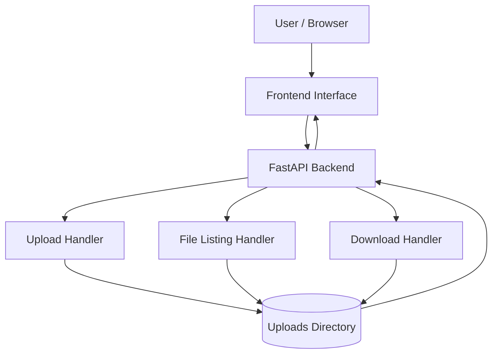

<div align="center">

# 📁 File Sharing Server

### A Simple & Efficient File Upload and Download Application

A web-based file-sharing application built using **Python and FastAPI**, designed to upload, manage, list and download files through a browser.

<br/>

[](https://python.org/)
[](https://fastapi.tiangolo.com/)
[](https://www.uvicorn.org/)
[](https://github.com/bharat19334/DevOps-Tasks)

</div>

---

## 📌 Overview

The **File Sharing Server** is a web-based application that provides a simple way to transfer files between a browser and a backend server.

Built with FastAPI, the application handles file uploads, displays uploaded files, and provides download functionality.

The project focuses on understanding server-side file handling, API development, and client-server communication using Python.

## ✨ Key Features

| Feature | Description |
|---|---|
| 📤 File Upload | Upload files to the server |
| 📥 File Download | Download previously uploaded files |
| 📂 File Listing | View available uploaded files |
| ⚡ FastAPI Backend | Handle file operations through REST APIs |
| 💾 File Storage | Store uploaded files on the server |
| 🌐 Browser Access | Interact with the application through a web interface |
| 🔄 File Handling | Manage file operations on the backend |

## 🛠️ Technology Stack

| Technology | Purpose |
|---|---|
| Python | Backend programming |
| FastAPI | API development |
| Uvicorn | ASGI server |
| HTML | Frontend structure |
| CSS | Interface styling |
| JavaScript | Frontend interactions |
| Git & GitHub | Version control |

## 🏗️ System Architecture



## 🔄 How It Works

### 1. File Upload
- User selects a file.
- Frontend sends the file to the backend.
- FastAPI processes the upload request.
- File is stored in the server's uploads directory.

### 2. File Listing
- Backend retrieves available uploaded files.
- File information is returned to the frontend.
- The interface displays the available files.

### 3. File Download
- User selects a file.
- A download request is sent to the backend.
- Backend locates the requested file.
- File is returned to the browser.

## 📂 Project Structure

```text
File-Sharing-Server/
│
├── app/
│   └── main.py
│
├── uploads/
│   └── uploaded files
│
├── tests/
│
├── requirements.txt
├── .gitignore
└── README.md
```

## ⚙️ Installation & Setup

### Prerequisites

- Python 3.10+
- pip
- Git
- VS Code

### 1. Clone Repository

```bash
git clone https://github.com/bharat19334/DevOps-Tasks.git
```

### 2. Navigate to Project

```bash
cd DevOps-Tasks/File-Sharing-Server
```

### 3. Create Virtual Environment

```bash
python -m venv venv
```

### 4. Activate Environment

**Windows:**

```bash
venv\Scripts\activate
```

**Linux / macOS:**

```bash
source venv/bin/activate
```

### 5. Install Dependencies

```bash
pip install -r requirements.txt
```

### 6. Run the Application

```bash
uvicorn app.main:app --reload
```

### 7. Open in Browser

```text
http://127.0.0.1:8000
```

## 🔌 API Documentation

FastAPI provides interactive API documentation through Swagger UI.

Open:

```text
http://127.0.0.1:8000/docs
```

### Core Operations

| Operation | Purpose |
|---|---|
| File Upload | Send files to the server |
| File Listing | Retrieve uploaded file information |
| File Download | Download a selected file |

Refer to Swagger UI for the exact API methods, endpoint paths, and request parameters.

## 🧪 Testing

- [ ] Start the FastAPI server.
- [ ] Open the application in a browser.
- [ ] Upload a sample file.
- [ ] Verify the file is stored successfully.
- [ ] Check the uploaded file list.
- [ ] Download an uploaded file.
- [ ] Verify the downloaded file.

## 🔐 Security Considerations

This project demonstrates basic file handling. Before using it in a public production environment, consider:

- File type and extension validation.
- Maximum upload size restrictions.
- Safe filename handling.
- Path traversal protection.
- Authentication and authorization.
- HTTPS communication.
- Access control for uploaded files.

## 🚀 Future Enhancements

- [ ] User authentication.
- [ ] Secure file-sharing links.
- [ ] File deletion functionality.
- [ ] File size validation.
- [ ] Upload progress indicator.
- [ ] Cloud storage integration.
- [ ] Docker containerization.
- [ ] Automated testing and CI/CD pipeline.

## 📚 Learning Outcomes

Through this project, I explored:

- Building backend applications using FastAPI.
- Handling file uploads in Python.
- Managing files on a server.
- Implementing file download functionality.
- Building and testing REST APIs.
- Understanding client-server communication.
- Working with server-side file storage.

## 👨‍💻 Author

<div align="center">

### Bharat Goswami

**B.Tech | Computer Science & Engineering (AI/ML)**

[](https://github.com/bharat19334)

[](https://www.linkedin.com/in/bharatgoswami19/)

</div>

---

<div align="center">

**Built with Python and FastAPI.**

⭐ If you find this project useful, consider giving it a star!

</div>
