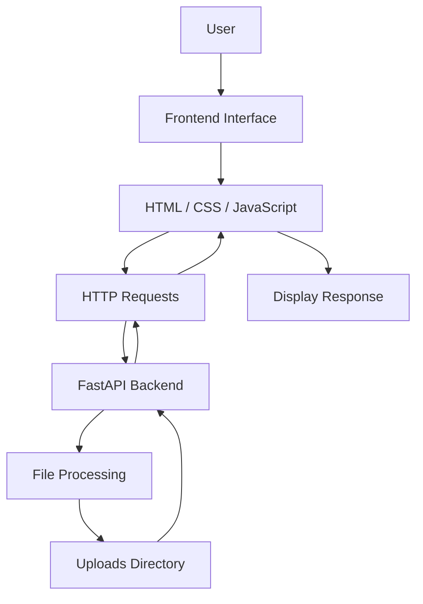
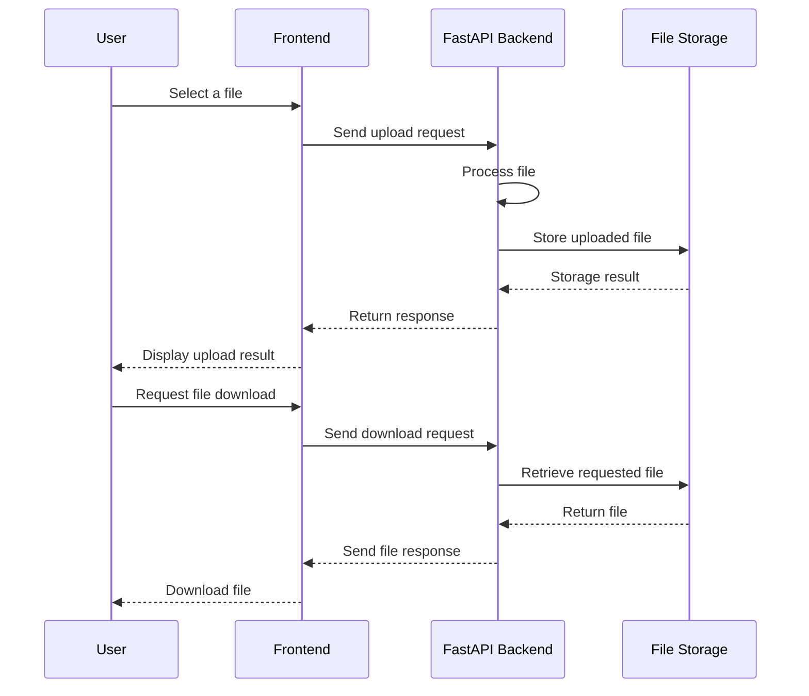

# 📁 File Sharing Server

<p align="center">
  A FastAPI-based web application for uploading, managing, and downloading files through a simple and interactive frontend.
</p>

<p align="center">
  
  
  
  
  
  
</p>

---

## 📌 Project Overview

The **File Sharing Server** is a web-based application developed using Python and FastAPI that provides a simple way to upload and download files through a browser.

The application uses a FastAPI backend to process file-related requests and a frontend built with HTML, CSS, and JavaScript to provide an interactive user interface.

Uploaded files are stored inside a dedicated `uploads/` directory on the server.

This project demonstrates practical implementation of file handling, REST API development, frontend-backend integration, and automated testing.

---

## ✨ Key Features

- 📤 **File Upload:** Upload files through the web interface.
- 📥 **File Download:** Download files stored on the server.
- 📂 **File Storage:** Maintain uploaded files in a dedicated directory.
- 🌐 **Interactive Frontend:** User interface built using HTML, CSS, and JavaScript.
- ⚡ **FastAPI Backend:** Handle file operations through backend APIs.
- 🔄 **Frontend-Backend Integration:** Communicate with the backend using JavaScript requests.
- 🧪 **Automated Testing:** Test application functionality using Pytest.
- 📖 **API Documentation:** Explore and test APIs through Swagger UI.

---

## 🛠️ Technology Stack

| Technology | Usage |
|---|---|
| Python | Backend programming |
| FastAPI | Backend API framework |
| Uvicorn | ASGI server |
| HTML5 | Frontend structure |
| CSS3 | Frontend styling |
| JavaScript | Frontend functionality |
| Pytest | Automated testing |
| Git & GitHub | Version control |

---

## 🏗️ System Architecture

The application follows a client-server architecture.



### Architecture Components

**1. Frontend Layer**

- `index.html` provides the main application interface.
- `style.css` manages the visual design.
- `script.js` handles frontend interactions and API communication.

**2. Backend Layer**

- `main.py` contains the FastAPI application.
- Processes incoming HTTP requests.
- Handles file-related operations.

**3. Storage Layer**

- The `uploads/` directory stores uploaded files.
- The backend accesses stored files for supported file operations.

**4. Testing Layer**

- `test_main.py` contains automated application tests.

---

## 📂 Project Structure

```text
File-Sharing-Server/
│
├── app/
│   ├── __init__.py
│   └── main.py
│
├── frontend/
│   ├── css/
│   │   └── style.css
│   │
│   ├── js/
│   │   └── script.js
│   │
│   └── index.html
│
├── tests/
│   └── test_main.py
│
├── uploads/
│   └── .gitkeep
│
├── .gitignore
├── requirements.txt
└── README.md
```

### Folder Description

| Path | Responsibility |
|---|---|
| `app/` | Backend application package |
| `app/main.py` | FastAPI application and server-side logic |
| `frontend/` | Frontend application files |
| `frontend/index.html` | Main user interface |
| `frontend/css/style.css` | Application styling |
| `frontend/js/script.js` | Frontend logic and API communication |
| `tests/` | Automated test cases |
| `tests/test_main.py` | Backend testing |
| `uploads/` | Uploaded file storage |
| `uploads/.gitkeep` | Preserves the empty directory in Git |
| `.gitignore` | Excludes unnecessary files |
| `requirements.txt` | Python dependencies |
| `README.md` | Project documentation |

---

## 🔄 Application Workflow



---

## ⚙️ Installation and Setup

### 1. Clone the Repository

```bash
git clone https://github.com/bharat19334/DevOps-Tasks.git
```

### 2. Navigate to the Project

```bash
cd DevOps-Tasks/File-Sharing-Server
```

### 3. Create a Virtual Environment

```bash
python -m venv venv
```

### 4. Activate Virtual Environment

**Windows:**

```powershell
venv\Scripts\Activate
```

**Linux / macOS:**

```bash
source venv/bin/activate
```

### 5. Install Dependencies

```bash
pip install -r requirements.txt
```

### 6. Start the FastAPI Server

```bash
uvicorn app.main:app --reload
```

### 7. Access the Application

| Service | URL |
|---|---|
| Web Application | http://127.0.0.1:8000 |
| Swagger UI | http://127.0.0.1:8000/docs |
| ReDoc | http://127.0.0.1:8000/redoc |

---

## 🔌 API Documentation

The backend is powered by FastAPI, which automatically generates interactive API documentation.

Open Swagger UI:

```text
http://127.0.0.1:8000/docs
```

Through Swagger UI, you can:

- Explore registered API endpoints.
- Inspect request parameters.
- Execute API requests.
- View response details.
- Test backend functionality.

*Exact endpoint names, HTTP methods, and request formats should be taken from the application's registered routes.*

---

## 🧪 Testing

The project includes a test module:

```text
tests/
└── test_main.py
```

Run the test suite:

```bash
pytest
```

Run tests with detailed output:

```bash
pytest -v
```

---

## 🔐 Security Considerations

Important considerations for a file-sharing application:

- Validate uploaded file extensions and content types.
- Apply file size restrictions.
- Generate safe filenames.
- Prevent path traversal attacks.
- Restrict access to sensitive files.
- Avoid exposing internal server directories.
- Use HTTPS for public deployments.

---

## ⚠️ Current Limitations

- Files are stored on the local server filesystem.
- No cloud storage integration is included.
- Authentication and user-specific access control are not established by the documented project structure.
- File availability may depend on the server's persistent storage configuration.
- Large file uploads may require additional resource management.

---

## 🚀 Future Enhancements

- User authentication and authorization.
- Secure file-sharing links.
- File expiration and automatic cleanup.
- Cloud storage integration using AWS S3.
- File size and type validation.
- File management dashboard.
- Docker containerization.
- Deployment with persistent storage.

---

## 📚 Learning Outcomes

Through this project, I gained practical experience in:

- Building REST APIs using FastAPI.
- Implementing file upload and download functionality.
- Integrating frontend and backend applications.
- Handling HTTP requests and responses.
- Managing local file storage.
- Structuring Python backend projects.
- Writing automated tests using Pytest.
- Working with virtual environments and dependencies.

---

## 👨‍💻 Author

**Bharat Goswami**

B.Tech CSE (AI/ML)  
Career Point University, Kota, Rajasthan

- GitHub: [@bharat19334](https://github.com/bharat19334)

---

<p align="center">
  <strong>Built with Python, FastAPI and JavaScript</strong>
</p>

<p align="center">
  ⭐ If you find this project useful, consider giving it a star!
</p>