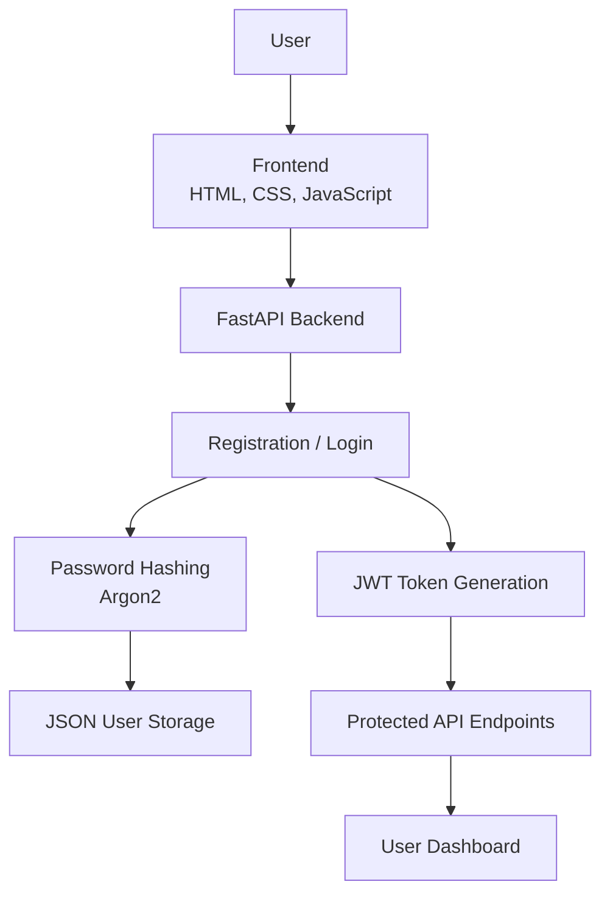

<div align="center">

# 🔐 AuthFlow

### Secure Authentication System Without a Traditional Database

A lightweight authentication application built with **FastAPI, Python, JavaScript, JWT and Argon2**.

<br/>

[](https://signupandloginwithoutdb.onrender.com)
[](https://www.python.org/)
[](https://fastapi.tiangolo.com/)
[](https://render.com/)

<br/>

**[Live Application](https://signupandloginwithoutdb.onrender.com) · [GitHub Repository](https://github.com/bharat19334/DevOps-Tasks)**

</div>

---

## 📌 Overview

**AuthFlow** is a web-based authentication system that demonstrates user registration, login, password hashing, and token-based authentication without using a traditional database.

The application uses a JSON file to store user records, **Argon2** for password hashing, and **JWT (JSON Web Tokens)** to secure protected API endpoints.

It combines a Python backend with a responsive frontend to demonstrate how a complete authentication workflow works.

## ✨ Features

| Feature | Description |
|---|---|
| 👤 User Registration | Register new users with email and password |
| 🔑 User Login | Authenticate existing users |
| 🔒 Password Hashing | Secure password hashing using Argon2 |
| 🎟️ JWT Authentication | Token-based authentication |
| 🛡️ Protected APIs | Restrict access to authenticated endpoints |
| 📊 User Dashboard | Display authenticated user information |
| 📁 JSON Storage | Store user records without a traditional database |
| 🚪 Logout | Clear the stored authentication token |
| ☁️ Cloud Deployment | Live deployment on Render |

## 🛠️ Technology Stack

| Layer | Technologies |
|---|---|
| Backend | Python, FastAPI |
| Frontend | HTML5, CSS3, JavaScript |
| Authentication | JWT |
| Password Security | Argon2 |
| Storage | JSON File |
| API Documentation | Swagger UI |
| Version Control | Git, GitHub |
| Deployment | Render |

## 🏗️ Architecture



## 🔄 Authentication Workflow

### 1. User Registration
- User enters registration details.
- Frontend sends a request to the signup endpoint.
- Backend validates the input.
- Password is hashed using Argon2.
- User information is stored in the JSON file.

### 2. User Login
- User submits email and password.
- Backend verifies the password hash.
- A JWT access token is generated after successful authentication.

### 3. Protected Dashboard
- Frontend sends the JWT with authenticated API requests.
- Backend validates the token.
- Authenticated user information is returned.
- Dashboard displays the user details.

### 4. Logout
- The stored JWT is cleared from browser local storage.
- User is redirected to the login page.

## 📂 Project Structure

```text
Signup-Login-Without-Database/
│
├── app/
│   ├── __init__.py
│   └── main.py
│
├── frontend/
│   ├── index.html
│   ├── signup.html
│   ├── dashboard.html
│   │
│   ├── css/
│   │   └── style.css
│   │
│   └── js/
│       ├── auth.js
│       └── dashboard.js
│
├── data/
│   └── users.json
│
├── requirements.txt
├── .gitignore
└── README.md
```

## 🔌 API Endpoints

| Method | Endpoint | Description |
|---|---|---|
| `GET` | `/` | Login page |
| `GET` | `/signup` | Signup page |
| `GET` | `/dashboard` | Dashboard page |
| `GET` | `/api/health` | Application health check |
| `POST` | `/api/signup` | Register a new user |
| `POST` | `/api/login` | Authenticate a user |
| `GET` | `/api/me` | Retrieve authenticated user details |
| `GET` | `/api/protected` | Access protected resource |

### API Documentation

FastAPI provides interactive API documentation through Swagger UI.

**Local:**
```text
http://127.0.0.1:8000/docs
```

**Live:**
```text
https://signupandloginwithoutdb.onrender.com/docs
```

## ⚙️ Installation & Setup

### Prerequisites

- Python 3.10+
- Git
- VS Code or another code editor

### 1. Clone the Repository

```bash
git clone https://github.com/bharat19334/DevOps-Tasks.git
```

### 2. Navigate to the Project

```bash
cd DevOps-Tasks/Signup-Login-Without-Database
```

### 3. Create a Virtual Environment

```bash
python -m venv venv
```

### 4. Activate the Environment

**Windows:**
```bash
venv\Scripts\activate
```

**Linux / macOS:**
```bash
source venv/bin/activate
```

### 5. Install Dependencies

```bash
pip install -r requirements.txt
```

### 6. Initialize JSON Storage

Create `data/users.json` with:

```json
[]
```

### 7. Configure Environment Variable

Generate a secure secret key:

```bash
python -c "import secrets; print(secrets.token_urlsafe(32))"
```

Set the generated value as `SECRET_KEY` in your environment.

### 8. Start the Application

```bash
uvicorn app.main:app --reload
```

### 9. Open in Browser

```text
http://127.0.0.1:8000
```

## ☁️ Deployment

The application is deployed on **Render** as a Python Web Service.

| Configuration | Value |
|---|---|
| Platform | Render |
| Service Type | Web Service |
| Runtime | Python |
| Build Command | `pip install -r requirements.txt` |
| Start Command | `uvicorn app.main:app --host 0.0.0.0 --port $PORT` |

**Live URL:** [https://signupandloginwithoutdb.onrender.com](https://signupandloginwithoutdb.onrender.com)

> **Storage Note:** Render's default filesystem is ephemeral. User records stored in `users.json` may be lost after a restart or redeployment. Persistent storage is required to retain data.

## 🔐 Security Considerations

- Passwords are stored as Argon2 hashes, not plain-text passwords.
- JWT is used to authenticate protected API requests.
- Secret keys are configured through environment variables.
- HTTPS should be used for secure communication.
- Browser local storage has limitations in the presence of XSS vulnerabilities.
- JSON file storage is intended for learning and demonstration, not concurrent production workloads.

## 🎯 Learning Outcomes

Through this project, I explored:

- Building REST APIs using FastAPI.
- Implementing user registration and authentication.
- Password hashing and verification with Argon2.
- JWT token generation and validation.
- Creating protected API endpoints.
- Integrating JavaScript with a Python backend.
- Managing user records using JSON files.
- Deploying a FastAPI application on Render.

## 🚀 Future Enhancements

- [ ] Email verification
- [ ] Password reset functionality
- [ ] Role-based access control
- [ ] Refresh token implementation
- [ ] Login rate limiting
- [ ] Persistent database integration
- [ ] Secure HttpOnly cookie-based authentication
- [ ] Automated testing and CI/CD pipeline

## 👨‍💻 Author

<div align="center">

### Bharat Goswami

**B.Tech | Computer Science & Engineering (AI/ML)**

[](https://github.com/bharat19334)
[](https://www.linkedin.com/in/bharatgoswami19/)

</div>

---

<div align="center">

**Built with Python, FastAPI and a focus on authentication fundamentals.**

⭐ If you find this project useful, consider giving it a star!

</div>
