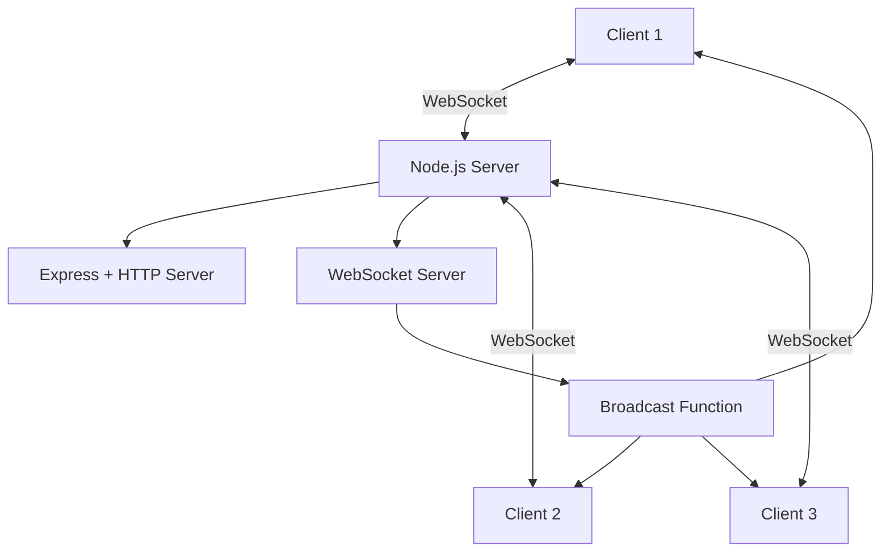

<div align="center">

# ⚡ Real-Time WebSocket Chat

### A Real-Time Multi-User Chat Application

A lightweight real-time messaging application built using **Node.js, Express.js, and WebSocket**.

Connect multiple users and exchange messages instantly without refreshing the page.

<br/>

[](https://nodejs.org/)
[](https://expressjs.com/)
[](https://developer.mozilla.org/en-US/docs/Web/API/WebSockets_API)
[](https://developer.mozilla.org/en-US/docs/Web/JavaScript)

</div>

---

## 📌 Overview

This project demonstrates real-time communication using the WebSocket protocol.

Unlike traditional HTTP request-response communication, WebSocket maintains a persistent connection between the client and server, allowing messages to be exchanged instantly in both directions.

The application uses a Node.js server with Express.js and the `ws` library to manage multiple connected clients.

Whenever a user sends a message, the server broadcasts it to all currently connected clients.

## ✨ Key Features

| Feature | Description |
|---|---|
| ⚡ Real-Time Messaging | Exchange messages instantly |
| 👥 Multiple Clients | Support multiple simultaneous connections |
| 📢 Message Broadcasting | Send messages to all connected clients |
| 🟢 Join Notifications | Notify users when someone joins |
| 🔴 Leave Notifications | Notify users when someone disconnects |
| 🕒 Message Timestamps | Attach local time to chat messages |
| 🔌 Connection Management | Track active WebSocket connections |
| 🌐 Static File Hosting | Serve frontend files through Express |

## 🛠️ Technology Stack

| Technology | Purpose |
|---|---|
| Node.js | JavaScript runtime |
| Express.js | HTTP server and static file hosting |
| WebSocket (`ws`) | Real-time bidirectional communication |
| HTTP Module | Create the underlying HTTP server |
| JavaScript | Server-side application logic |
| HTML, CSS | Frontend interface, if included in `public/` |

## 🏗️ System Architecture



## 🔄 How It Works

### 1. Server Initialization

- Express creates the application.
- HTTP creates the underlying server.
- WebSocket attaches to the HTTP server.
- Express serves static files from the `public` directory.

### 2. Client Connection

When a client connects:

- WebSocket accepts the connection.
- Server tracks the connected client.
- A system notification is broadcast to all connected users.

### 3. Message Broadcasting

When a client sends a message:

1. Server receives the WebSocket message.
2. Incoming data is converted into a JavaScript object.
3. Message details are extracted.
4. Server broadcasts the message to all connected clients.
5. Only clients with an open WebSocket connection receive the message.

### 4. Client Disconnection

When a user disconnects:

- Server detects the closed connection.
- Connected client count is updated.
- A user-left notification is broadcast.

## 📂 Project Structure

```text
websocket-chat/
│
├── public/
│   ├── index.html
│   ├── style.css
│   └── script.js
│
├── server.js
├── package.json
├── package-lock.json
└── README.md
```

> The frontend filenames above represent a suggested structure. Adjust them to match your actual project files.

## ⚙️ Installation & Setup

### Prerequisites

- Node.js
- npm
- VS Code or another code editor

### 1. Clone Repository

```bash
git clone https://github.com/bharat19334/DevOps-Tasks.git
```

### 2. Navigate to Project

```bash
cd DevOps-Tasks/websocket-chat
```

### 3. Install Dependencies

```bash
npm install
```

Required packages:

```bash
npm install express ws
```

### 4. Start the Server

```bash
node server.js
```

Expected output:

```text
Server is running at: http://localhost:3000
```

### 5. Open Application

Open the following URL in your browser:

```text
http://localhost:3000
```

Open the application in multiple browser tabs to test real-time communication between clients.

## 🔌 WebSocket Communication

The application uses JSON messages for communication between clients and the server.

### Chat Message Format

```json
{
  "name": "Bharat",
  "text": "Hello everyone!"
}
```

### Server Broadcast Format

```json
{
  "type": "chat",
  "name": "Bharat",
  "text": "Hello everyone!",
  "time": "10:30:45 pm"
}
```

### System Notification

```json
{
  "type": "system",
  "text": "A new user joined. Online users: 2"
}
```

## 🧠 Core Implementation

The main server functionality is implemented using the following components:

| Component | Responsibility |
|---|---|
| Express App | Serves static frontend files |
| HTTP Server | Handles incoming HTTP requests |
| WebSocket Server | Manages client connections |
| Broadcast Function | Sends messages to connected clients |
| Connection Event | Handles new client connections |
| Message Event | Processes incoming chat messages |
| Close Event | Handles client disconnections |

## 🧪 Testing

Test the following scenarios:

- [ ] Open the application in multiple browser tabs.
- [ ] Connect multiple clients.
- [ ] Verify new user join notifications.
- [ ] Send a message from one client.
- [ ] Verify that all connected clients receive the message.
- [ ] Check message timestamps.
- [ ] Close one browser tab.
- [ ] Verify user disconnect notifications.

## 🔐 Current Limitations

This project is a basic real-time messaging implementation.

- No user authentication.
- No persistent message storage.
- No private messaging.
- Messages are broadcast to all connected clients.
- No message history after server restart.
- No production-level rate limiting or input validation.

## 🚀 Future Enhancements

- [ ] User authentication and usernames.
- [ ] Private one-to-one messaging.
- [ ] Chat rooms and group conversations.
- [ ] Persistent message storage.
- [ ] Online user list.
- [ ] Typing indicators.
- [ ] Message delivery status.
- [ ] Improved input validation and security.
- [ ] Production deployment with WSS.

## 📚 Learning Outcomes

Through this project, I explored:

- Real-time communication using WebSocket.
- Creating HTTP servers using Node.js.
- Integrating Express.js with WebSocket.
- Managing multiple concurrent client connections.
- Broadcasting messages to connected clients.
- Handling connection and disconnection events.
- Working with JSON-based client-server communication.

## 👨‍💻 Author

<div align="center">

### Bharat Goswami

**B.Tech | Computer Science & Engineering (AI/ML)**

[](https://github.com/bharat19334)

[](https://www.linkedin.com/in/bharatgoswami19/)

</div>

---

<div align="center">

**Built with Node.js, Express.js and WebSocket.**

⭐ If you find this project useful, consider giving it a star!

</div>
